# SMAact3_t4 — CRUD en Spring Boot con JPA, MySQL y relaciones entre entidades

| | |
|---|---|
| **Alumno** | Angel Sixto Morales (SMA) |
| **Materia** | Programación Web — Ing. Adelina Martínez Nieto |
| **Grupo** | 7SD — Instituto Tecnológico de Oaxaca (TecNM) |
| **Actividad** | Act3. CRUD en Spring Boot y Relaciones (sin frontend separado) |
| **Proyecto en el VPS** | http://157.180.30.55:PUERTO/alumnos |
| **API en el VPS** | http://157.180.30.55:PUERTO/api/alumnos |

---

## Índice

1. [Descripción del proyecto](#1-descripción-del-proyecto)
2. [Tecnologías utilizadas](#2-tecnologías-utilizadas)
3. [Modelo de datos y relación entre entidades](#3-modelo-de-datos-y-relación-entre-entidades)
4. [Arquitectura en capas](#4-arquitectura-en-capas)
5. [Explicación de cada capa](#5-explicación-de-cada-capa)
6. [CRUD: endpoints](#6-crud-endpoints)
7. [Configuración y seguridad de credenciales](#7-configuración-y-seguridad-de-credenciales)
8. [Evidencias (capturas de pantalla)](#8-evidencias-capturas-de-pantalla)
9. [Cómo ejecutar el proyecto en local](#9-cómo-ejecutar-el-proyecto-en-local)
10. [Despliegue en el VPS](#10-despliegue-en-el-vps)
11. [Cuestionario](#11-cuestionario)

---

## 1. Descripción del proyecto

Sistema de **control de alumnos** de un instituto. Permite **registrar, consultar, editar y eliminar
alumnos** (CRUD), y cada alumno queda asociado a la **carrera** que estudia.

Toda la información se guarda en una base de datos **MySQL** real. El proyecto se puede usar de dos formas,
**dentro del mismo proyecto Spring Boot** y sin frontend separado:

- **Vistas web** hechas con Thymeleaf y Bootstrap (navegador).
- **API REST** que responde JSON (probada con Postman).

Las dos formas usan la misma lógica de negocio (capa Service) y la misma base de datos.

### Requisitos de la actividad y dónde se cumplen

| Requisito | Dónde se cumple |
|---|---|
| Proyecto con Spring Web, Spring Data JPA y MySQL Driver (+ Thymeleaf) | `pom.xml` |
| `application.properties` con los datos de la base | `src/main/resources/application.properties` + `db.properties` |
| Dos entidades relacionadas (no city/country) | `Carrera` y `Alumno` en `models/entity/` |
| Relación JPA con llave foránea | `@ManyToOne` + `@JoinColumn(name = "carrera_id")` en `Alumno`, `@OneToMany(mappedBy = "carrera")` en `Carrera` |
| Un Repository por entidad que extienda `JpaRepository` | `CarreraRepository`, `AlumnoRepository` en `repository/` |
| Service con la lógica de negocio | `CarreraService`, `AlumnoService` en `service/` |
| Controller con los 4 endpoints del CRUD | `AlumnoController` (vistas) y `AlumnoRestController` (API) |
| La relación se refleja (nombre de la carrera, no solo el id) | Columna "Carrera" de la lista y objeto `carrera` en el JSON |
| Datos que persisten en MySQL | Comprobado en MySQL Workbench (sección 8) |
| Credenciales fuera del repositorio | `db.properties` en `.gitignore` (sección 7) |
| Desplegado en un puerto nuevo del VPS | Puerto `PUERTO` (sección 10) |

---

## 2. Tecnologías utilizadas

| Tecnología | Para qué se usa |
|---|---|
| **Java 17** | Lenguaje de programación |
| **Spring Boot** | Framework base; trae el servidor Tomcat embebido |
| **Spring Web** | Controladores, rutas (`@GetMapping`, `@PostMapping`...) y API REST |
| **Spring Data JPA** | Repositorios para acceder a la base sin escribir SQL |
| **Hibernate** | Implementación de JPA (ORM): convierte clases en tablas y genera el SQL |
| **MySQL 8 + MySQL Driver** | Base de datos relacional y el conector JDBC |
| **Thymeleaf** | Motor de plantillas para las vistas HTML |
| **Bootstrap 5** | Estilos de las vistas (tablas, botones, formularios) |
| **Spring Boot DevTools** | Reinicio automático al guardar cambios |
| **Maven** | Gestión de dependencias y compilación |
| **MySQL Workbench** | Crear la base, revisar tablas, relación y datos |
| **Postman** | Probar la API REST |

---

## 3. Modelo de datos y relación entre entidades

### Entidades

**Carrera** (tabla `carreras`)

| Campo | Tipo | Descripción |
|---|---|---|
| `id` | INT, PK, autoincremental | Identificador |
| `clave` | VARCHAR(10) | Clave corta (ej. `ISC`) |
| `nombre` | VARCHAR(100) | Nombre completo de la carrera |

**Alumno** (tabla `alumnos`), entidad principal del CRUD

| Campo | Tipo | Descripción |
|---|---|---|
| `id` | INT, PK, autoincremental | Identificador |
| `numero_control` | VARCHAR(20) | Número de control |
| `nombre` | VARCHAR(60) | Nombre(s) |
| `apellidos` | VARCHAR(80) | Apellidos |
| `email` | VARCHAR(100) | Correo |
| `semestre` | INT | Semestre que cursa |
| `carrera_id` | INT, **FK** → `carreras.id` | Carrera a la que pertenece |

### Relación: uno a muchos (1:N)

```
        carreras                                alumnos
┌──────────────────────┐              ┌──────────────────────────┐
│ id (PK)              │ 1          N │ id (PK)                  │
│ clave                │──────────────│ numero_control           │
│ nombre               │              │ nombre                   │
└──────────────────────┘              │ apellidos                │
                                      │ email                    │
                                      │ semestre                 │
                                      │ carrera_id (FK) ─────────┼──► carreras.id
                                      └──────────────────────────┘
```

- **Una carrera tiene muchos alumnos** → `@OneToMany` en `Carrera`.
- **Muchos alumnos pertenecen a una carrera** → `@ManyToOne` en `Alumno`.

### Cómo se implementa con JPA

**`Alumno.java`** es el lado "muchos" y el **dueño de la relación**, porque es el que tiene la llave foránea:

```java
@ManyToOne(fetch = FetchType.EAGER, optional = false)
@JoinColumn(name = "carrera_id", nullable = false)
private Carrera carrera;
```

- `@ManyToOne`: muchos alumnos → una carrera.
- `@JoinColumn(name = "carrera_id")`: crea en la tabla `alumnos` la columna **`carrera_id`** como
  **llave foránea** hacia `carreras.id`.
- `nullable = false`: todo alumno debe tener carrera.
- `FetchType.EAGER`: al leer un alumno se trae también su carrera, para poder mostrar su nombre.

**`Carrera.java`** es el lado "uno" o inverso:

```java
@OneToMany(mappedBy = "carrera")
@JsonIgnore
private List<Alumno> alumnos = new ArrayList<>();
```

- `mappedBy = "carrera"`: indica que la relación ya está definida en el atributo `carrera` de `Alumno`,
  así que **no se crea otra columna**. Solo permite navegar de la carrera a sus alumnos.
- `@JsonIgnore`: evita un **ciclo infinito** al convertir a JSON
  (alumno → carrera → alumnos → carrera → ...).

La llave foránea la crea **Hibernate** automáticamente al arrancar la aplicación
(`spring.jpa.hibernate.ddl-auto=update`). En MySQL queda así (`SHOW CREATE TABLE alumnos`):

```sql
KEY `FK...` (`carrera_id`),
CONSTRAINT `FK...` FOREIGN KEY (`carrera_id`) REFERENCES `carreras` (`id`)
```

---

## 4. Arquitectura en capas

```
Navegador (vistas)  ──┐
                      ├──►  CONTROLLER  ──►  SERVICE  ──►  REPOSITORY  ──►  MySQL
Postman (API REST)  ──┘    (recibe la       (lógica de    (acceso a       (tablas
                            petición)         negocio)      datos, JPA)     carreras y
                                                                           alumnos)
```

```
src/main/java/mx/edu/itoaxaca/smaact3/
├── Smaact3Application.java          # Clase principal (@SpringBootApplication)
├── models/entity/                   # MODELO: entidades JPA
│   ├── Carrera.java
│   └── Alumno.java
├── repository/                      # ACCESO A DATOS
│   ├── CarreraRepository.java
│   └── AlumnoRepository.java
├── service/                         # LÓGICA DE NEGOCIO
│   ├── CarreraService.java
│   └── AlumnoService.java
└── controllers/                     # CONTROLADORES
    ├── HomeController.java          # "/" redirige a /alumnos
    ├── AlumnoController.java        # CRUD de alumnos con vistas Thymeleaf
    ├── CarreraController.java       # CRUD de carreras con vistas Thymeleaf
    └── api/
        ├── AlumnoRestController.java    # CRUD de alumnos en JSON (API REST)
        └── CarreraRestController.java   # Carreras en JSON (API REST)

src/main/resources/
├── application.properties           # Configuración (BD, JPA, Thymeleaf)
└── templates/                       # VISTAS
    ├── alumnos/lista.html           # Tabla de alumnos + filtro por carrera
    ├── alumnos/formulario.html      # Crear / editar alumno
    ├── carreras/lista.html          # Tabla de carreras + número de alumnos
    └── carreras/formulario.html     # Crear / editar carrera

database/                            # Scripts SQL para MySQL Workbench
postman/                             # Colección de Postman
db.properties.example                # Plantilla de credenciales (la real no se sube)
```

---

## 5. Explicación de cada capa

### 5.1 Entidades (`models/entity`)

Son clases Java que representan las tablas. Usan anotaciones de JPA:

| Anotación | Qué hace |
|---|---|
| `@Entity` | Marca la clase como entidad (se guarda en la base) |
| `@Table(name = "alumnos")` | Nombre de la tabla |
| `@Id` | Llave primaria |
| `@GeneratedValue(strategy = IDENTITY)` | Id autoincremental de MySQL |
| `@Column(...)` | Nombre, longitud y si permite nulos |
| `@ManyToOne` / `@JoinColumn` | Relación muchos a uno y llave foránea |
| `@OneToMany(mappedBy = ...)` | Lado inverso de la relación |

### 5.2 Repositorios (`repository`)

Son **interfaces** que extienden `JpaRepository<Entidad, TipoDelId>`. Spring genera su implementación,
así que no se escribe SQL para el CRUD:

```java
public interface AlumnoRepository extends JpaRepository<Alumno, Integer> {
    List<Alumno> findByCarreraId(Integer carreraId);   // SELECT ... WHERE carrera_id = ?
    boolean existsByCarreraId(Integer carreraId);
}
```

| Método heredado | SQL que genera Hibernate |
|---|---|
| `findAll()` | `SELECT * FROM alumnos` |
| `findById(id)` | `SELECT * FROM alumnos WHERE id = ?` |
| `save(alumno)` | `INSERT` si es nuevo, `UPDATE` si ya existe |
| `deleteById(id)` | `DELETE FROM alumnos WHERE id = ?` |

`findByCarreraId` es una **consulta derivada**: Spring la arma a partir del nombre del método.

### 5.3 Servicios (`service`)

Contienen la **lógica de negocio**. Los controladores no acceden directamente a los repositorios.

Reglas implementadas:

- **`AlumnoService.asignarCarrera()`**: del formulario o del JSON solo llega el **id** de la carrera.
  El servicio busca la carrera real en la base y la asigna. Si no se eligió carrera o no existe,
  lanza un error con un mensaje claro.
- **`CarreraService.eliminar()`**: **no permite eliminar una carrera que tiene alumnos**, porque esos
  alumnos quedarían con una llave foránea apuntando a nada.
- Los métodos usan **`@Transactional`**: si algo falla, la operación se revierte completa.
- Las dependencias se reciben por **inyección por constructor**: Spring pasa los repositorios automáticamente.

### 5.4 Controladores (`controllers`)

Solo reciben la petición, llaman al servicio y regresan una **vista** o un **JSON**.

- **`AlumnoController`** (`@Controller`): regresa vistas Thymeleaf.
- **`AlumnoRestController`** (`@RestController`): regresa JSON.

Los dos usan el **mismo `AlumnoService`**, así que la lógica no se repite.

### 5.5 Vistas (`templates`)

Hechas con **Thymeleaf** y **Bootstrap**:

- `th:each` recorre la lista de alumnos.
- `${a.carrera.nombre}` muestra el **nombre de la carrera** del alumno: así se refleja la relación.
- `th:object` y `th:field` enlazan el formulario con la entidad; el `<select>` envía `carrera.id`.
- El botón **Eliminar** pide confirmación antes de borrar.
- Los mensajes de éxito o error se muestran con alertas de Bootstrap.

---

## 6. CRUD: endpoints

### 6.1 Vistas (navegador)

| Operación | Método | Ruta | Qué hace |
|---|---|---|---|
| **Leer** | GET | `/alumnos` | Lista de alumnos con su carrera |
| Leer (filtro) | GET | `/alumnos?carreraId=1` | Alumnos de una carrera (`@RequestParam`) |
| **Crear** | GET | `/alumnos/nuevo` | Muestra el formulario vacío |
| **Crear** | POST | `/alumnos` | Guarda el alumno nuevo |
| **Actualizar** | GET | `/alumnos/editar/{id}` | Formulario con los datos actuales |
| **Actualizar** | POST | `/alumnos/editar/{id}` | Guarda los cambios |
| **Eliminar** | POST | `/alumnos/eliminar/{id}` | Elimina al alumno |
| Carreras | GET | `/carreras` | Catálogo de carreras y número de alumnos |

### 6.2 API REST (JSON)

| Operación | Método | Ruta | Respuesta |
|---|---|---|---|
| **Leer** todos | GET | `/api/alumnos` | 200 + lista |
| **Leer** uno | GET | `/api/alumnos/{id}` | 200 o 404 |
| **Crear** | POST | `/api/alumnos` | 201 + alumno creado |
| **Actualizar** | PUT | `/api/alumnos/{id}` | 200 o 404 |
| **Eliminar** | DELETE | `/api/alumnos/{id}` | 204 o 404 |
| Carreras | GET | `/api/carreras` | 200 + lista |
| Relación 1:N | GET | `/api/carreras/{id}/alumnos` | Alumnos de esa carrera |

**Body para crear o actualizar un alumno:**

```json
{
  "numeroControl": "24160404",
  "nombre": "Carlos",
  "apellidos": "Hernandez Diaz",
  "email": "carlos.hernandez@example.com",
  "semestre": 1,
  "carrera": { "id": 1 }
}
```

**Respuesta (la carrera viene completa, no solo el id):**

```json
{
  "id": 5,
  "numeroControl": "24160404",
  "nombre": "Carlos",
  "apellidos": "Hernandez Diaz",
  "email": "carlos.hernandez@example.com",
  "semestre": 1,
  "carrera": {
    "id": 1,
    "clave": "ISC",
    "nombre": "Ingenieria en Sistemas Computacionales"
  }
}
```

La colección de Postman con todas las peticiones está en
[`postman/SMAact3_t4.postman_collection.json`](postman/SMAact3_t4.postman_collection.json).
Para probar en el VPS, cambia la variable `baseUrl` de la colección.

---

## 7. Configuración y seguridad de credenciales

`application.properties` **no contiene usuario ni contraseña reales**:

```properties
spring.datasource.url=${DB_URL:jdbc:mysql://localhost:3306/smaact3_db?...}
spring.datasource.username=${DB_USER:root}
spring.datasource.password=${DB_PASSWORD:}
spring.config.import=optional:file:./db.properties

spring.jpa.hibernate.ddl-auto=update   # Hibernate crea/actualiza las tablas
spring.jpa.show-sql=true               # muestra el SQL generado
spring.thymeleaf.cache=false
```

Las credenciales se leen de un archivo **`db.properties`**, ubicado en la carpeta desde donde se ejecuta
la aplicación. Ese archivo está en **`.gitignore`**, así que **no se sube a GitHub**.
Como plantilla se incluye `db.properties.example`:

```properties
spring.datasource.username=TU_USUARIO
spring.datasource.password=TU_CONTRASENA
```

Así, en mi computadora uso mi usuario local y en el VPS un usuario propio con su propia contraseña,
sin cambiar el código. También se pueden usar las variables de entorno `DB_URL`, `DB_USER` y `DB_PASSWORD`.

---

## 8. Evidencias (capturas de pantalla)

### 8.1 Base de datos y relación en MySQL Workbench

**Diagrama de las dos entidades relacionadas (llave foránea `carrera_id`):**

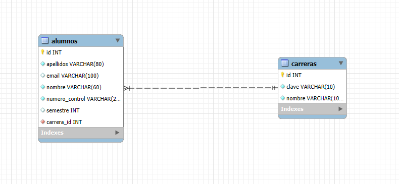

**Llave foránea creada por Hibernate (`SHOW CREATE TABLE alumnos`):**

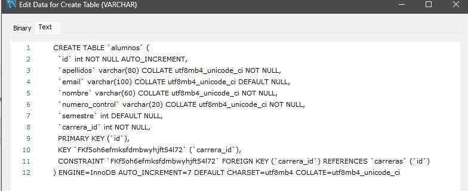

**Datos persistidos con la relación (JOIN alumnos–carreras):**

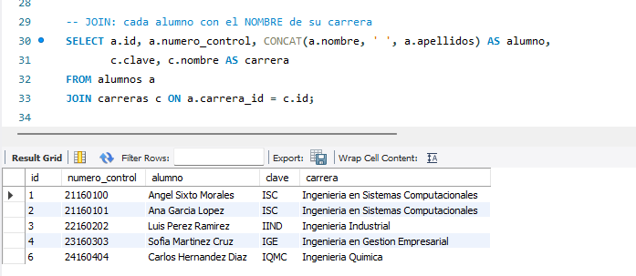

### 8.2 CRUD desde las vistas

**LEER: lista de alumnos con el nombre de su carrera:**

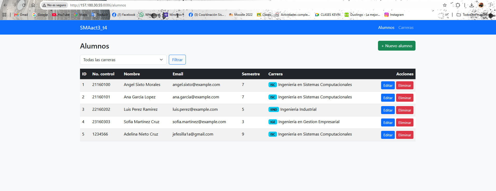

**CREAR: formulario de registro:**

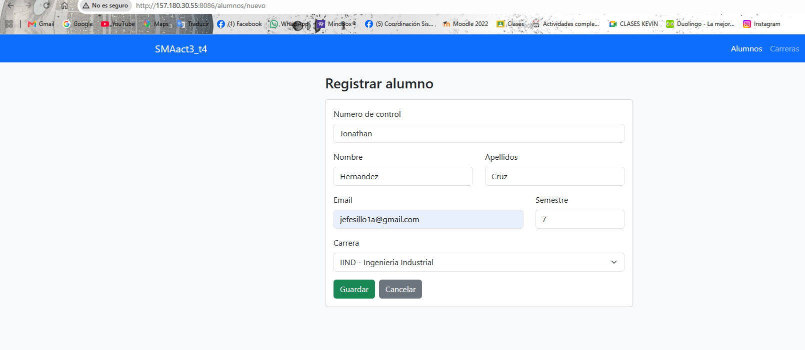

**CREAR: alumno guardado en la lista:**

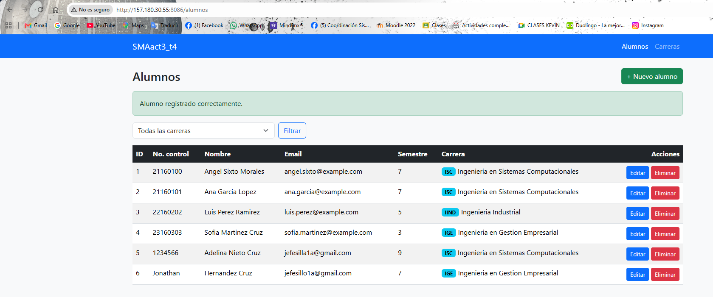

**ACTUALIZAR: edición del alumno (cambio de carrera):**

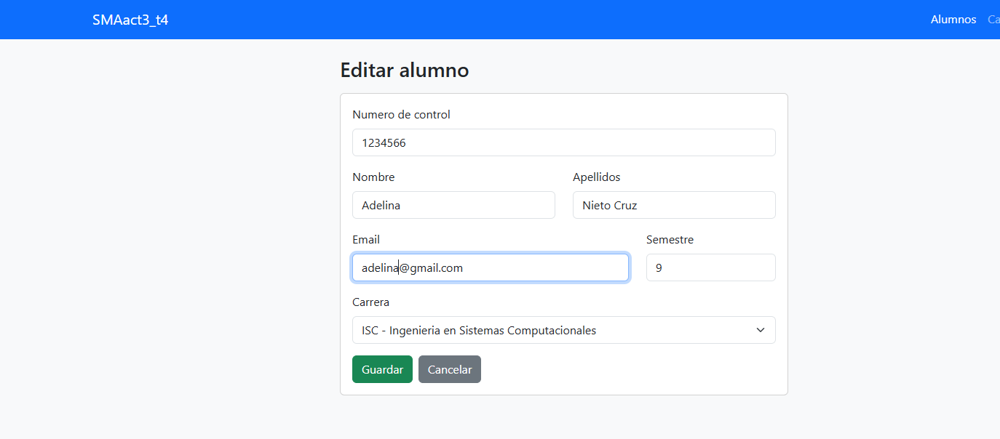

**ELIMINAR: confirmación y resultado:**

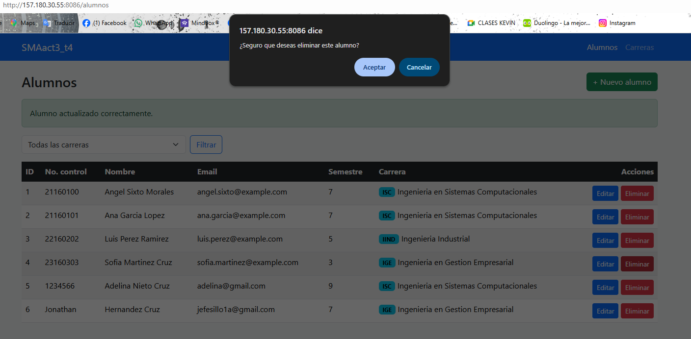

**Relación desde el lado "uno": carreras con su número de alumnos:**

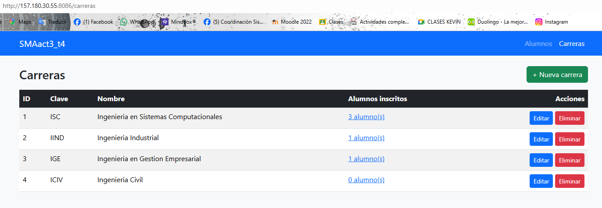

### 8.3 CRUD desde la API REST (Postman)

| Operación | Captura |
|---|---|
| **POST** crear (201 Created, con la carrera en la respuesta) | 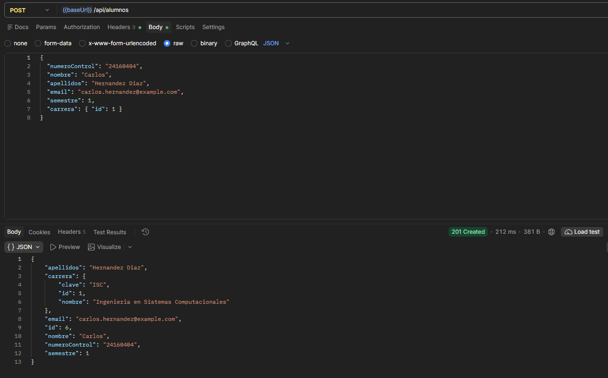 |
| **GET** leer todos (200 OK) | 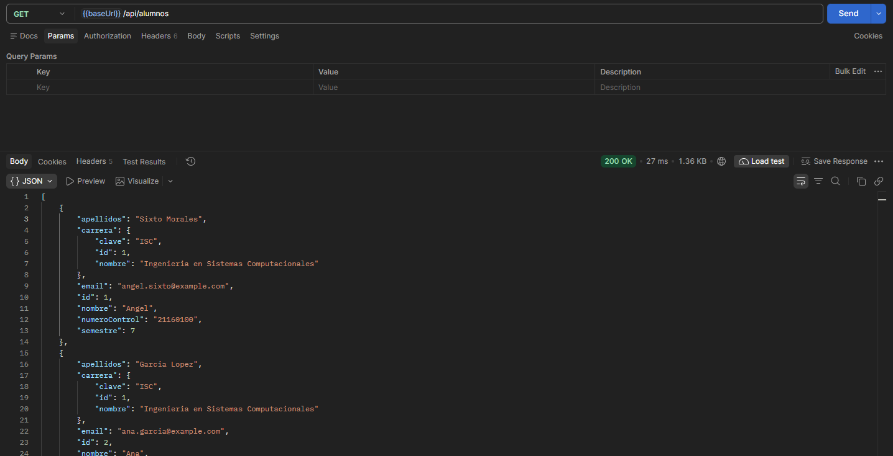 |
| **PUT** actualizar (200 OK) | 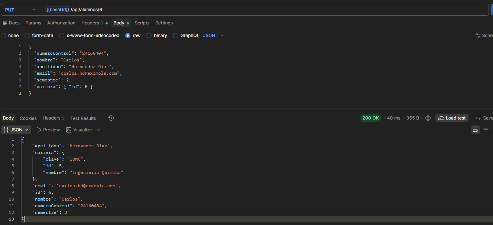 |
| **DELETE** eliminar (204 No Content) | 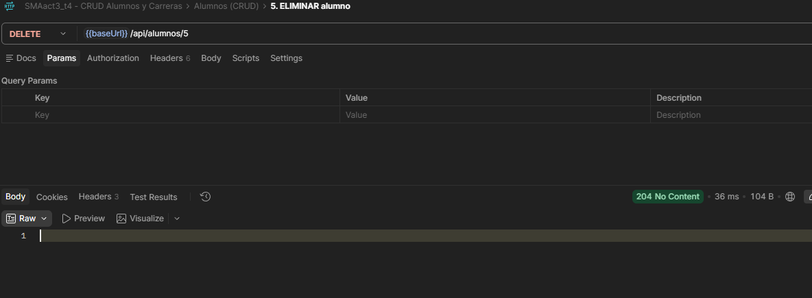 |
| **GET** alumnos de una carrera (relación 1:N) |  |

### 8.4 Despliegue en el VPS

**Proyecto corriendo en el VPS en su propio puerto:**


**Las tres actividades corriendo al mismo tiempo:**


---

## 9. Cómo ejecutar el proyecto en local

**Requisitos:** JDK 17 o superior, MySQL 8 y MySQL Workbench.

1. **Crear la base de datos:** en MySQL Workbench, abrir y ejecutar `database/01_crear_base.sql`.
2. **Credenciales:** copiar `db.properties.example` como `db.properties`, en la raíz del proyecto,
   y escribir el usuario y la contraseña de MySQL.
3. **Ejecutar:**
   ```bash
   ./mvnw spring-boot:run        # Windows: .\mvnw spring-boot:run
   ```
   Hibernate crea las tablas `carreras` y `alumnos` y la llave foránea.
4. **Datos de ejemplo (opcional):** ejecutar `database/02_datos_ejemplo.sql` en Workbench.
5. Abrir **http://localhost:8080**

---

## 10. Despliegue en el VPS

El proyecto corre en un **puerto propio (`PUERTO`)** y en una **carpeta propia (`/root/smaact3`)**,
sin afectar a las actividades anteriores:

| Actividad | Carpeta | Puerto |
|---|---|---|
| Act. 1 | `/root/smaact1` | 8082 |
| Act. 2 | `/root/smaact2` | 8084 |
| **Act. 3** | **`/root/smaact3`** | **PUERTO** |

1. Se creó la base `smaact3_db` y un usuario de MySQL exclusivo para esta app en el VPS.
2. Las credenciales del VPS están en `/root/smaact3/db.properties`, no en el repositorio.
3. Compilación y subida:
   ```bash
   ./mvnw clean package -DskipTests
   scp target/smaact3-0.0.1-SNAPSHOT.jar root@157.180.30.55:/root/smaact3/
   ```
4. Ejecución en segundo plano:
   ```bash
   cd /root/smaact3
   nohup java -Xmx256m -jar smaact3-0.0.1-SNAPSHOT.jar --server.port=PUERTO > app.log 2>&1 &
   ```

---

## 11. Cuestionario

### a) ¿Qué dos entidades elegiste y qué tipo de relación implementaste entre ellas?

Elegí **Carrera** y **Alumno**, con una relación **uno a muchos / muchos a uno**: una carrera tiene
muchos alumnos y cada alumno pertenece a una sola carrera.

- En `Alumno` usé `@ManyToOne` con `@JoinColumn(name = "carrera_id")`. Esto crea en la tabla `alumnos`
  la columna `carrera_id` como **llave foránea** hacia `carreras.id`. Es el lado dueño de la relación.
- En `Carrera` usé `@OneToMany(mappedBy = "carrera")`, que es el lado inverso: permite obtener la lista
  de alumnos de una carrera sin crear otra columna.

Al consultar un alumno se muestra el nombre y la clave de su carrera, no solo su id.

### b) ¿Qué es un Repository en Spring Data JPA y qué ventaja tiene sobre escribir tú mismo las consultas SQL?

Un Repository es una **interfaz** que se encarga del acceso a la base de datos para una entidad.
Al extender `JpaRepository<Alumno, Integer>` (entidad y tipo de su llave primaria), Spring genera
automáticamente la implementación con los métodos del CRUD: `findAll()`, `findById()`, `save()`,
`deleteById()`, `existsById()`, etc.

Ventajas:
- No escribo SQL para las operaciones comunes; Hibernate lo genera.
- Puedo crear consultas con solo nombrar el método, por ejemplo `findByCarreraId(Integer id)`,
  y Spring genera el `SELECT ... WHERE carrera_id = ?`.
- Menos código y menos errores, porque el SQL se adapta al motor de base de datos (dialecto de MySQL).
- Las consultas usan parámetros, lo que evita inyección SQL.
- Trabajo con objetos Java en lugar de filas y columnas.

### c) ¿Por qué es una buena práctica separar la lógica en una capa de Service en vez de ponerla directamente en el Controller?

Porque cada capa tiene **una sola responsabilidad**:

- El **Controller** solo recibe la petición, llama al servicio y regresa una vista o un JSON.
- El **Service** contiene las reglas de negocio. Por ejemplo, que un alumno debe pertenecer a una
  carrera existente, o que no se puede borrar una carrera con alumnos.
- El **Repository** solo accede a la base de datos.

Beneficios:
- **Reutilización:** en este proyecto, `AlumnoController` (vistas) y `AlumnoRestController` (API)
  usan el mismo `AlumnoService`, así que la lógica no se repite.
- **Mantenimiento:** si cambia una regla, se cambia en un solo lugar.
- **Pruebas:** el servicio se puede probar sin levantar el servidor web.
- **Transacciones:** con `@Transactional` en el servicio, varias operaciones se guardan o se revierten juntas.
- Controladores más cortos y fáciles de leer.

### d) Enlaces

- **Repositorio de GitHub:** https://github.com/TU_USUARIO/SMAact3_t4
- **Proyecto en el VPS (vistas):** http://157.180.30.55:PUERTO/alumnos
- **API en el VPS:** http://157.180.30.55:PUERTO/api/alumnos
- **Colección de Postman:** [`postman/SMAact3_t4.postman_collection.json`](postman/SMAact3_t4.postman_collection.json)
- **Actividades anteriores, que siguen corriendo:**
  [Act. 1 (8082)](http://157.180.30.55:8082/proyecto) ·
  [Act. 2 (8084)](http://157.180.30.55:8084/empleados)
